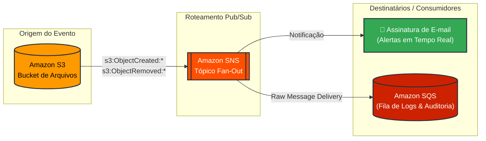

# 🔔 Notificações de Eventos Amazon S3 com Amazon SNS e Amazon SQS (Arquitetura Fan-Out na AWS)

Projeto prático de infraestrutura em nuvem na AWS demonstrando a implementação de uma arquitetura orientada a eventos (*Event-Driven Architecture*) para notificação e registro de operações de armazenamento.

---

## 📌 Visão Geral do Projeto

Este projeto visa criar um sistema automatizado de monitoramento e auditoria para buckets do **Amazon S3**. Sempre que um objeto é carregado (`s3:ObjectCreated:*`) ou excluído (`s3:ObjectRemoved:*`), os eventos são capturados e distribuídos simultaneamente:

1. **Notificação por E-mail (SNS):** Alertas em tempo real para a equipe de administração.
2. **Registro de Log em Fila (SQS):** Retenção e rastreabilidade dos eventos em JSON bruto (*Raw Message Delivery*) para auditorias posteriores.

---

## 🏗️ Arquitetura da Solução



### O Padrão Fan-Out
A utilização do **Amazon SNS** entre o S3 e o SQS desacopla a origem dos eventos dos destinatários. Com a topologia Fan-Out, o S3 publica uma única mensagem no SNS, que se encarrega de entregá-la para múltiplos assinantes simultaneamente.

---

## 🛠️ Serviços AWS Utilizados

- **Amazon S3:** Armazenamento de arquivos e disparo de notificações de eventos.
- **Amazon SNS:** Distribuição de mensagens Pub/Sub.
- **Amazon SQS:** Fila de mensagens para armazenamento persistente dos logs.
- **AWS IAM:** Políticas baseadas em recursos (*Resource-based Policies*) para segurança de acesso inter-serviços.

---

## 📋 Passo a Passo de Implementação

### 1. Criação do Bucket S3
- **Região:** `us-east-1` (Norte da Virgínia).
- **Nome do bucket:** `eventos-s3-[seu-nome]-[data]` (ex: `eventos-s3-robertasilva20231028`).
- **Configurações:** Manter padrão/desabilitado nas demais opções.
- **ARN do Bucket:** Copiar o Amazon Resource Name (ARN) na aba *Propriedades* após a criação.

### 2. Criação do Tópico SNS e Assinatura de E-mail
- **Tipo:** Padrão (*Standard*).
- **Nome:** `notificacoes-s3-[seu-nome]-[data]`.
- **ARN do Tópico:** Copia do ARN para uso nas políticas.
- **Assinatura:** 
  - **Protocolo:** E-mail.
  - **Endpoint:** E-mail de destino.
  - **Confirmação:** Confirmação obrigatória via link enviado pela AWS ao e-mail informado.

### 3. Criação da Fila SQS
- **Tipo:** Fila padrão (*Standard*).
- **Nome:** `fila-eventos-s3-[seu-nome]-[data]`.
- **ARN da Fila:** Copia do ARN para permissões e assinatura.

---

## 🔐 Políticas de Acesso IAM (JSON)

### 4. Configuração da Política do Tópico SNS
Edição da política baseada em recurso do tópico no console do SNS, autorizando o serviço `s3.amazonaws.com` a publicar no tópico com restrição condicional ao ARN do bucket (`aws:SourceArn`).

```json
{
  "Version": "2008-10-17",
  "Id": "__default_policy_ID",
  "Statement": [
    {
      "Sid": "__default_statement_ID",
      "Effect": "Allow",
      "Principal": {
        "AWS": "*"
      },
      "Action": [
        "SNS:Publish",
        "SNS:RemovePermission",
        "SNS:SetTopicAttributes",
        "SNS:DeleteTopic",
        "SNS:ListSubscriptionsByTopic",
        "SNS:GetTopicAttributes",
        "SNS:Receive",
        "SNS:AddPermission",
        "SNS:Subscribe"
      ],
      "Resource": "ARN_DO_SEU_TOPICO_SNS",
      "Condition": {
        "StringEquals": {
          "AWS:SourceOwner": "SEU_ID_DE_CONTA_AWS_12_DIGITOS"
        }
      }
    },
    {
      "Sid": "AllowS3ToPublishToTopic",
      "Effect": "Allow",
      "Principal": {
        "Service": "s3.amazonaws.com"
      },
      "Action": "SNS:Publish",
      "Resource": "ARN_DO_SEU_TOPICO_SNS",
      "Condition": {
        "ArnLike": {
          "aws:SourceArn": "ARN_DO_SEU_BUCKET_S3"
        }
      }
    }
  ]
}
```

### 5. Configuração da Política da Fila SQS
Edição da política baseada em recurso da fila no console do SQS, permitindo a ação `sqs:SendMessage` pelo serviço `sns.amazonaws.com` restrita ao ARN do tópico SNS (`aws:SourceArn`).

```json
{
  "Version": "2012-10-17",
  "Id": "__default_policy_ID",
  "Statement": [
    {
      "Sid": "__default_statement_ID",
      "Effect": "Allow",
      "Principal": {
        "AWS": "*"
      },
      "Action": [
        "SQS:SendMessage",
        "SQS:ReceiveMessage",
        "SQS:DeleteMessage",
        "SQS:GetQueueAttributes",
        "SQS:SetQueueAttributes",
        "SQS:ListQueues"
      ],
      "Resource": "ARN_DA_SUA_FILA_SQS"
    },
    {
      "Sid": "AllowSNSToSendMessageToSQS",
      "Effect": "Allow",
      "Principal": {
        "Service": "sns.amazonaws.com"
      },
      "Action": "sqs:SendMessage",
      "Resource": "ARN_DA_SUA_FILA_SQS",
      "Condition": {
        "ArnEquals": {
          "aws:SourceArn": "ARN_DO_SEU_TOPICO_SNS"
        }
      }
    }
  ]
}
```

---

## ⚙️ Conexão de Eventos e Assinatura SQS

### 6. Notificações no S3
- **Nome da Notificação:** `NotificarPutDelete`.
- **Eventos selecionados:**
  - `s3:ObjectCreated:*` (Todos os eventos de criação de objeto).
  - `s3:ObjectRemoved:*` (Todos os eventos de remoção de objeto).
- **Destino:** Tópico do SNS selecionado.

### 7. Assinatura SQS no Tópico SNS
- **Protocolo:** Amazon SQS.
- **Endpoint:** ARN completo da fila SQS.
- **Raw Message Delivery (Conteúdo de mensagem bruta):** Habilitado para entregar o payload JSON original do S3 diretamente à fila sem invólucro do SNS.

---

## 🧪 Validação e Testes

### Teste 1: Upload de Arquivo
1. Upload de arquivo realizado no bucket S3.
2. E-mail de notificação recebido imediatamente na caixa de entrada.
3. Leitura de mensagens (*Poll for messages*) na fila SQS, verificando a estrutura do evento JSON referente a `ObjectCreated:Put`.

### Teste 2: Exclusão de Arquivo
1. Exclusão do arquivo realizada no bucket S3.
2. Alerta de e-mail e log de evento `ObjectRemoved:Delete` capturados na fila SQS.

---

## 🧹 Limpeza de Recursos (*Teardown*)

Desprovisionamento dos recursos para prevenção de custos:
1. Esvaziamento e exclusão do Bucket S3.
2. Exclusão da Fila SQS.
3. Exclusão do Tópico SNS e de suas assinaturas.

---

## 👤 Autor

- **Desenvolvido por:** [Seu Nome]
- **LinkedIn:** [Seu LinkedIn]
- **GitHub:** [Seu GitHub]
